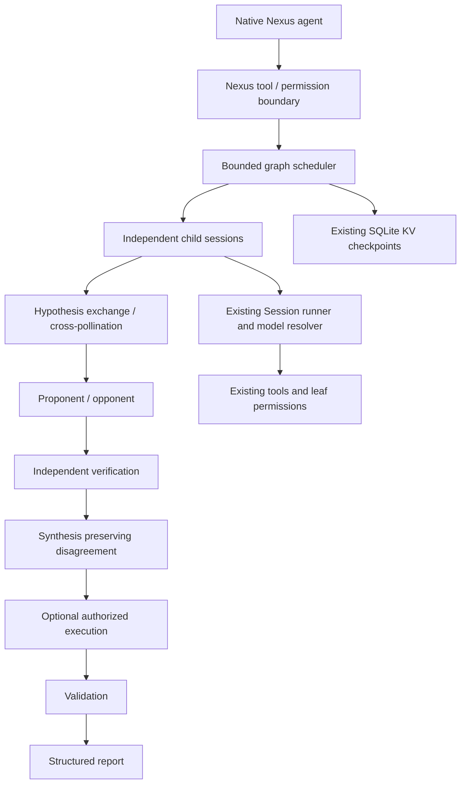

# KiduNexus repository assessment

Assessment date: 2026-10-28. Scope: this KiduCode CLI/OpenCode-sync repository, not the parent Cloud Console application. Existing Crew changes and the untracked CLI custom-tests directory are user work and are preserved.

## Verified architecture and extension points

| Concern | Existing owner | Integration decision |
| --- | --- | --- |
| Language/build | TypeScript, Bun workspaces, Turbo (`package.json`) | Modular monolith; no new infrastructure or dependencies |
| Agent inventory | `core/src/agent.ts`, `plugin/agent.ts`, `config/plugin/agent.ts` | Register a Nexus primary agent and logical worker roles through agent transforms |
| Execution | `session/execution.ts`, `session/runner/`, `session/subagent-job.ts` | Use durable child sessions and existing runner; never add a provider-side tool loop |
| Model routing | `model.ts`, `model-resolver.ts`, `session/runner/model.ts` | Resolve only available models and variants; reuse provider authentication |
| Tools | `tool.ts`, `tool/runtime.ts`, `tool/plugin/*` | Built-in Nexus tool; leaves retain authorization. A before-execute hook adds immutable worker restrictions |
| Permissions | `permission.ts`, `permission/saved.ts`, config policies | Child execution cannot grant permissions; check originating session policy as well as worker policy |
| Sessions | `session.ts`, durable inbox, event projections | Each worker has a separate history and the same explicit parent and Location |
| Context | `session/history.ts`, `session/compaction.ts`, `session/model-request.ts` | Bounded structured handoffs; native context limits and compaction remain authoritative |
| Usage | `session/usage.ts`, `schema/token-usage.ts`, `session.step.ended` | Report actual recorded worker usage; distinguish estimates and missing prices |
| Persistence | SQLite/Drizzle, `kv.ts`, durable Session events | Compact orchestration checkpoints in existing KV, namespaced by parent session; child history remains in Sessions |
| Configuration | `schema/config.ts`, `core/config.ts` | Validated native JSON/JSONC field. Resource ceilings compose restrictively across documents |
| Async/events | Effect v4, global Bus, SSE projections | Bounded Effect concurrency, cancellation finalizers, native tool progress and child events |
| UI | Solid/OpenTUI TUI, Solid web app, shared session-ui | Native agent picker, child sessions, permissions, streamed tool progress, inspectable reports; no new frontend |
| Plugins | `plugin/internal.ts`, Effect plugin hooks | Register in existing internal plugin lifecycle; retain standard provider/plugin boundaries |
| Verification | Bun test, core isolated test runner, Playwright/OpenTUI suites, Linux/Windows CI | Deterministic engine tests and session adapter integration, canonical root check |
| Retry/cancellation | SessionExecution, runner retry hooks, Effect interruption | Bounded workflow attempts; interrupt active child sessions on parent cancellation/deadline |
| Observability | durable session tool events, logs, usage records | Emit public summaries and evidence only, never request private chain-of-thought |

## Proposed runtime

Graph nodes have explicit dependencies, bounded rounds, terminal states, outputs, and provenance. A classifier selects a smaller graph for simple tasks. Workers return a validated public-result envelope, not hidden reasoning. Independent generation nodes receive only the task and classifier/decomposer output, never their peers' unfinished answers. Dependency results are passed as delimited untrusted data.

## Integration risks and decisions

- **Accounting:** provider usage is available after requests, not before. Preflight reservations must be explicitly identified as estimates; they cannot guarantee external billing or provider-internal reasoning limits. Unknown prices must not be represented as measured zero-cost work.
- **Cancellation:** child Session ownership is independent of the parent fiber. Explicit finalizers must interrupt children, including failures and deadline expiry. Do not detach workflow workers.
- **Authorization:** agent prompts and agent permissions alone are insufficient because configuration can override them. Worker tool execution must have a runtime allowlist and an originating-session permission check. Unknown tools fail closed for workers. Reasoning workers cannot invoke shell, subagents, or orchestration recursively.
- **Local execution:** this repository's ordinary shell is not an OS sandbox. Do not advertise sandbox isolation, and do not accept a sandbox flag unless an actual implementation exists. Existing permission approval remains necessary for execution.
- **Checkpointing:** a crash during a side effect is ambiguous. Never automatically replay an interrupted execution/validation node. Initial recovery may safely preserve reports and require a new explicitly authorized run rather than promise exactly-once execution.
- **Context isolation:** separate histories do not mean isolated files. Initial execution nodes are sequential; reasoning nodes cannot mutate files.
- **Evidence:** a model citation is a claim, not proof. Keep source identity, producing node, verification status, and challenges. Repeated URLs are not independent corroboration; unresolved claims remain visible.
- **Security:** redaction is defense in depth, not a promise to detect arbitrary secrets. Do not route credentials into worker prompts. Source material cannot change role, permissions, budgets, or graph execution policy.
- **UI:** existing generic tool and child-session UI can expose the initial end-to-end workflow without changing public HTTP APIs. A dedicated graph visualization is a separate UI increment and must not be claimed until tested.
- **Configuration contracts:** changing shared Config appears in generated clients; regenerate rather than hand-editing generated output.

## Incremental implementation strategy

1. Validate bounded configuration and public worker/report schemas; implement pure graph construction and evidence bookkeeping.
2. Build an Effect scheduler with bounded parallelism, dependencies, deadlines, explicit outcomes, and an injectable worker executor for deterministic tests.
3. Connect real child Sessions, permission gates, usage reservations, checkpoints, and native progress.
4. Exercise independent ideation → exchange → adversarial challenge → verification → synthesis, plus separately approved execution/validation.
5. Add reproducible benchmark manifests and measurement/report tooling without fabricated scores.
6. Document actual checks and remaining gaps. Never equate test-provider fixtures with measured live model quality.
